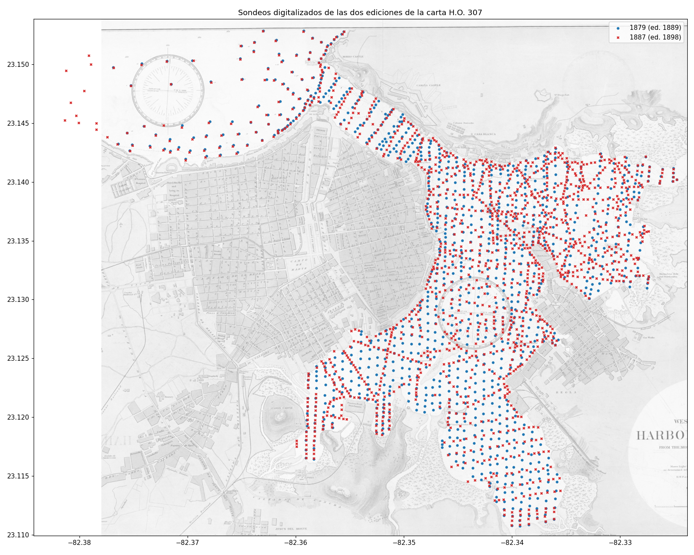
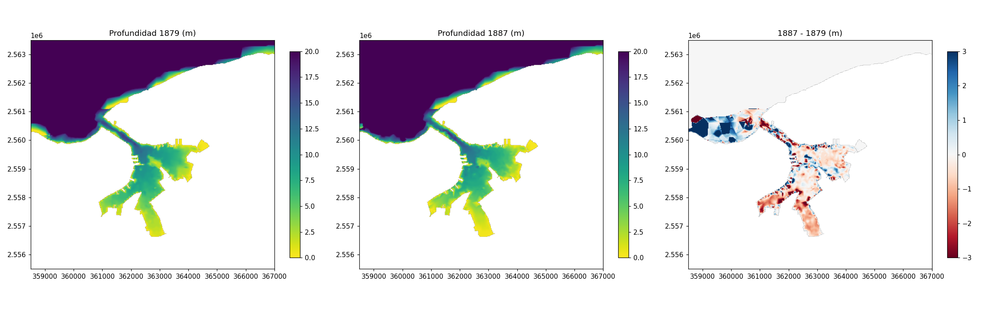
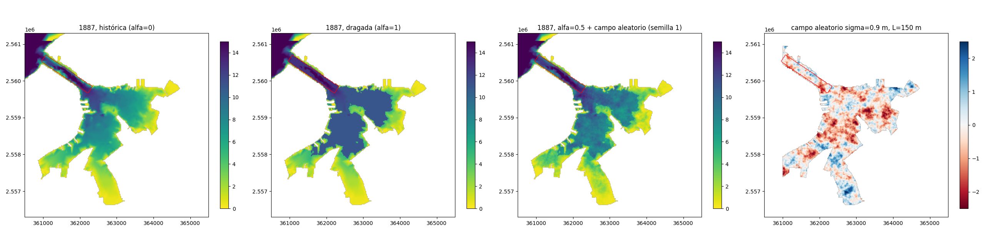
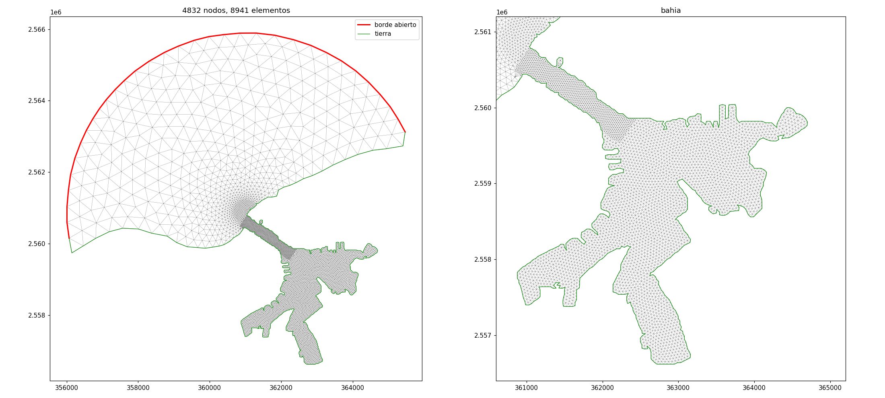
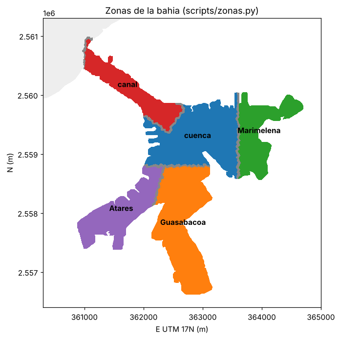
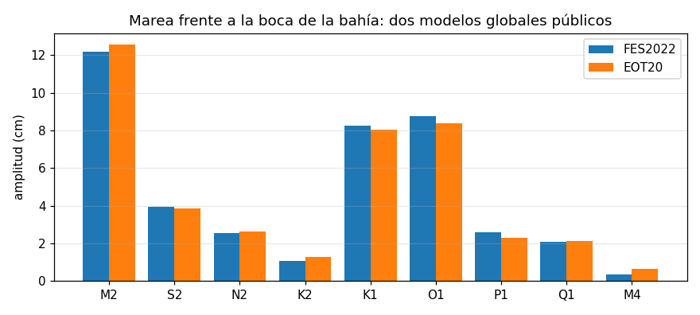
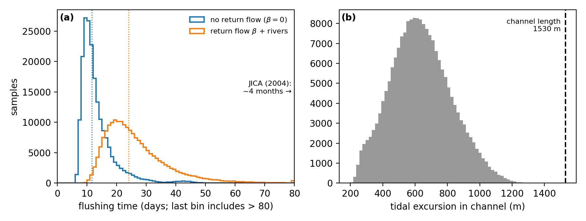
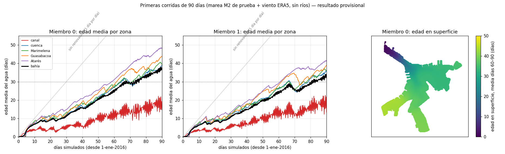

# Modelo hidrodinámico de la Bahía de La Habana — resumen del trabajo

*Alex Manuel Rivera · 21 de octubre de 2026*

## La pregunta

¿Qué se puede afirmar con seguridad sobre la renovación del agua de la Bahía de La Habana **sin mediciones propias**? No construimos un único modelo "calibrado", porque no hay datos con los que calibrarlo. En su lugar corremos **cientos de versiones del modelo** que recorren todo lo que no sabemos: la profundidad real, el dragado, el rozamiento del fondo, el viento y la marea. Así separamos dos tipos de conclusión:

- las **robustas**, que salen igual en todas las versiones;
- las **frágiles**, que dependen de lo que no sabemos. Para estas, un análisis de sensibilidad (índices de Sobol) dice qué incertidumbre pesa más y, por tanto, **qué conviene medir primero**.

**Regla del trabajo:** solo datos públicos, cada uno con su URL y fecha de acceso, para que cualquiera pueda repetirlo. No se compró ninguna carta ni se usaron datos privados.

Destino: artículo para *Environmental Modelling & Software*.

---

## 1. Lo que ya está hecho

### 1.1 Profundidad de la bahía a partir de cartas náuticas del siglo XIX

No existe una batimetría pública reciente del interior de la bahía. Usamos dos ediciones de la carta estadounidense n.º 307 *Harbor of Havana*, con levantamientos españoles **de 1879 y de 1887**:

- **2640 sondeos digitalizados a mano**: 1126 de 1879 y 1514 de 1887.
- Las dos cartas se alinearon automáticamente, con un error mediano de 1,2 m.
- Comparando una con otra se midió el error típico de las cartas: **0,9 m**, correlacionado a unos **150 m**. Ese error entra en el modelo como una perturbación aleatoria distinta en cada versión.

**Hallazgo:** con las cartas, la bahía tiene **4,9 km², 5–6 m de profundidad media y 26–36 hm³** de volumen. Las cifras que circulan (9 m y 47 hm³) no son compatibles ni con las cartas ni con los calados de los prácticos del puerto, aunque se suponga dragada toda la zona navegable. Como no sabemos cuánto se ha dragado desde el siglo XIX, el **estado de dragado** es una de las incertidumbres del modelo: va de la carta tal cual a todos los canales de acceso dragados a 11 m.

### 1.2 Malla y modelo

- **Modelo SCHISM 3D** (código abierto), con 16 niveles verticales y un módulo que calcula la **edad del agua**: los días que lleva dentro de la bahía desde que entró del mar o de un río.
- **Malla:** 4832 nodos, con 25 m de resolución en el canal y 40 m en la bahía.

Para resumir los resultados, la bahía se divide en cinco zonas:

### 1.3 Qué mueve el agua: viento, marea y ríos

- **Viento y atmósfera:** reanálisis ERA5, datos horarios de 2016 a 2025.
- **Marea:** dos modelos globales públicos e independientes, **FES2022** y **EOT20**. Frente a la boca de la bahía coinciden en menos de medio centímetro:

    | Componente | Amplitud |
    |---|---|
    | M2 | 12 cm |
    | K1 | 8 cm |
    | O1 | 8,5 cm |

    La marea es **mixta**: la parte diurna (K1, O1) pesa tanto como la semidiurna.

    

- **Ríos:**
    - **Caudales:** Luyanó 1,33 m³/s, Martín Pérez 0,72 m³/s y Tadeo 0,09 m³/s. Los tomamos del informe público de JICA de 2004, que recoge aforos del CIMAB de 2002.
    - **Desembocaduras:** de OpenStreetMap. Luyanó y Martín Pérez van a Guasabacoa; Tadeo, a Marimelena.
    - **Agua dulce:** el modelo la trata como más ligera que la de mar, para ver si se forma una capa en superficie.

### 1.4 Un cálculo a mano de referencia (prisma de marea)

Antes del modelo, un cálculo simple con incertidumbre da la escala que el modelo debe reproducir:

- **Caudal de marea por el canal:** unos **66 m³/s**.
- **Renovación con la marea:** del orden de **3 semanas**, entre 13 y 35 días.
- **Excursión de la marea:** unos 610 m, menos que la longitud del canal (1,5 km). El agua que sale en la vaciante vuelve a entrar en la llenante, así que la marea sola renueva mal.

### 1.5 Cálculo en el clúster

- **Dónde:** clúster Lemaitre4 de CÉCI (Bélgica).
- **Coste:** cada versión del modelo tarda **unas 3 horas por cada 3 meses simulados** con 6 núcleos.
- **El conjunto:** está diseñado con el método de Saltelli. Son **640 versiones**, que varían 8 incertidumbres:
    - qué carta se usa (1879 o 1887);
    - el estado de dragado;
    - el error de la carta;
    - el nivel de referencia de la carta;
    - el rozamiento del fondo;
    - la fuerza del viento;
    - la dirección del viento;
    - la amplitud de la marea.
- **Al terminar cada versión**, se calculan automáticamente la edad del agua por zona, el caudal por el canal y la edad en superficie a la hora de paso del satélite Sentinel-2, para compararla con las imágenes de turbidez.

---

## 2. Primeros resultados (provisionales)

Salen de **dos versiones de prueba de 90 días**, con una marea simplificada y sin ríos. **No son todavía las cifras finales.**

| Edad media del agua, días 60–90 | Versión 1 | Versión 2 |
|---|---|---|
| Bahía | 31 días | 28 días |
| Canal | 15 | 15 |
| Cuenca principal | 32 | 30 |
| Marimelena | 33 | 31 |
| Guasabacoa | 37 | 33 |
| **Atarés** | **41** | **36** |

**Lo que se ve:**

1. **El caudal de marea por el canal coincide con el cálculo a mano:** 64–74 m³/s frente a 66.
2. **El agua se renueva mucho más despacio que en el cálculo a mano.** A los 90 días la edad todavía crece, unos 0,4 días por día. Encaja con el informe de JICA, que estima unos **4 meses** para renovar el agua dulce. Si se confirma, será un resultado del artículo: el cálculo simple del prisma sobrestima la renovación.
3. **Las ensenadas son las zonas que no se renuevan, sobre todo Atarés.** El orden canal < cuenca < Marimelena < Guasabacoa < Atarés sale igual en las dos versiones. Es candidato a conclusión robusta.
4. Entre el 55 % y el 76 % del agua de la bahía tiene más de 30 días; en las ensenadas, prácticamente toda.

**Comprobaciones hechas:**

- El modelo es estable.
- Las condiciones en el borde con el mar abierto no alteran los resultados dentro de la bahía.
- Los dos modelos de marea coinciden.

---

## 3. Lo que estamos esperando

1. **Una corrida de un año completo**, en cola en el clúster. Arranque previsto: 22 de octubre. Dirá cuánto tarda la edad del agua en estabilizarse y, por tanto, cuánto debe durar cada una de las 640 versiones.
2. **Experimentos de mecanismo** con un año cada uno: solo marea, después marea + viento, después marea + viento + ríos. Separan qué renueva de verdad la bahía y si el agua dulce cambia el panorama en las ensenadas.
3. **Las 640 versiones** con la marea real y la duración decidida. De ahí salen:
    - el mapa de probabilidad de que el agua tenga más de 30 días;
    - el análisis de Sobol, que dice qué incertidumbre pesa más;
    - la lista de conclusiones robustas y frágiles.
4. **Después:**
    - seguimiento de partículas desde cada foco de vertido (qué fracción queda dentro a los 30, 60 y 90 días);
    - comparación cualitativa con 10 años de imágenes de turbidez de Sentinel-2.

**Qué nos ayudaría y está fuera de nuestro alcance:** cualquier medición pública de nivel del mar dentro de la bahía o una batimetría reciente. Si aparecieran, servirían solo para comparar al final, nunca como dato de entrada.
